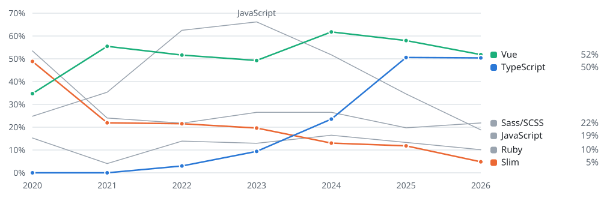

<picture>
  <source media="(prefers-color-scheme: dark)" srcset="assets/hero-dark.svg">
  
</picture>

Product engineer at Medods. I build interfaces, developer tools and agent workflows.
Vue, TypeScript, Ruby — and, since 2026, coding agents.

<table>
  <tr>
    <td align="center"><h3>4,964</h3>authored commits</td>
    <td align="center"><h3>1,004</h3>authored PRs merged</td>
    <td align="center"><h3>1,459</h3>others' PRs reviewed</td>
    <td align="center"><h3>1,028</h3>active commit days</td>
  </tr>
</table>

Mostly private work. Updated **24 November 2026**; searched from January 2019. [How this is counted](#how-this-is-counted).

## Highlights

| Result | Proof |
| --- | --- |
| Built developer tooling around coding agents | [Docker and Compose inside Orca](https://github.com/TAZAQ/orca-docker-plugin), with crash notifications |
| Fixed a race in Quackback's widget SDK: queued calls lost their handler argument | [quackback#113](https://github.com/QuackbackIO/quackback/pull/113) |

## Projects

| Project | What it does | Stack | Status |
| --- | --- | --- | --- |
| [orca-docker-plugin](https://github.com/TAZAQ/orca-docker-plugin) | Docker and Compose in the [Orca](https://github.com/stablyai/orca) side panel, with crash notifications | TypeScript | Public, agent-written |
| orca-git-plugin | JetBrains-style Git for Orca: commit, log graph, worktrees, diff, three-way merge | Rust, Vue 3 | Private, in progress |
| SLC | Runs agent sessions from a kanban board: task, branch, internal PR, review | Python, Vue 3 | Private |
| agent-chesnov | My writing, architecture and testing rules, packaged for coding agents | Markdown | Private |
| [skrepysh-chatgpt-pet](https://github.com/TAZAQ/skrepysh-chatgpt-pet) | Skrepysh, an animated paperclip pet for the Codex desktop app | Sprite sheet, Python | Public |
| [props-vuewer-2](https://github.com/TAZAQ/props-vuewer-2) | IntelliJ plugin that shows spread and imported Vue 2 props inline | Kotlin | Public |
| [ClickupRoutine](https://github.com/TAZAQ/ClickupRoutine) and [GUI](https://github.com/TAZAQ/ClickupRoutineGUI) | Release automation on top of ClickUp | Python, Vue 3 | Public |

Open source: 5 merged PRs in [Quackback](https://github.com/QuackbackIO/quackback/pulls?q=is%3Apr+author%3ATAZAQ+is%3Amerged), Russian locale for [VueFinder](https://github.com/n1crack/vuefinder/pull/4).

## How the stack moved

TypeScript went from no recorded code commits in 2021 to 53% in 2026. Slim fell from 41% in 2020 to 5%.
Rust (6%) and Python (1%) are also part of my 2026 mix.

<picture>
  <source media="(prefers-color-scheme: dark)" srcset="assets/stack-dark.svg">
  
</picture>

## When I commit

97% of commits land on weekdays. The busiest weekday/hour slot is Tuesday 15:00–15:59 (UTC+05:00).

<picture>
  <source media="(prefers-color-scheme: dark)" srcset="assets/rhythm-dark.svg">
  
</picture>

## How I work

- **Tests first.** Every bug gets a regression test.
- **Short code.** `if/else` beats a pattern when it is enough.
- **A test instead of a comment.** Code that needs explaining gets simpler.
- **Careful with user data.** Migrate only when needed: batched, idempotent, with a recovery plan.
- **Layers with seams.** Vue UI depends on one interface, so behaviour can be swapped without touching it.
- **Claims come with proof.** A quote, a file, a link.

## How this is counted

Method and the numbers behind the charts

- Period requested: 1 January 2019 through the collection timestamp below. No matching commits were found in 2019; the available authored history starts in August 2020.
- Commits: my verified author email addresses only, across 33 repositories' fetched branches and available local history; merge commits excluded. Copies from rebases, cherry-picks and forks are collapsed by author timestamp and subject. This heuristic can collapse distinct commits with the same timestamp and subject; it is not GitHub's contribution-calendar metric.
- PRs: GitHub search across accessible repositories for my authored PRs merged from 1 January 2019 through 24 November 2026, and distinct PRs by other authors created in that interval that I reviewed. These are PR counts, not my merge actions or review-event counts; review dates themselves are not filtered.
- Medods is private. My contributions are aggregated across its repositories; internal names, links, commit messages, task details and other people's work are not published.
- Language shares use commits touching the tracked code extensions as the denominator, not lines of code. One commit can touch several languages, so shares do not add up to 100%.
- Collected at **24 November 2026, 15:03 UTC**. Latest included author date: **23 November 2026**. Commit days and hours use **UTC+05:00**. Both 2020 and 2026 are partial years.
- An unavailable public fork was checked through the GitHub API: its only branch contained no commits matching my author addresses, so it adds nothing to these totals.

| Year | Commits | Vue | TypeScript | JavaScript | Sass/SCSS | Slim | Ruby |
| --- | ---: | ---: | ---: | ---: | ---: | ---: | ---: |
| 2019 | 0 | — | — | — | — | — | — |
| 2020 | 321 | 40% | 0% | 28% | 47% | 41% | 13% |
| 2021 | 670 | 55% | 0% | 38% | 22% | 20% | 4% |
| 2022 | 527 | 51% | 3% | 63% | 22% | 21% | 14% |
| 2023 | 525 | 49% | 9% | 66% | 26% | 20% | 13% |
| 2024 | 677 | 62% | 23% | 52% | 26% | 13% | 16% |
| 2025 | 694 | 58% | 49% | 36% | 20% | 11% | 13% |
| 2026 | 1,550 | 50% | 53% | 21% | 19% | 5% | 15% |

