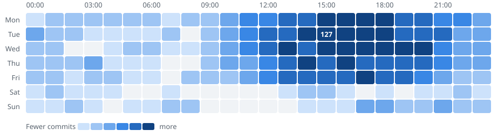

<picture>
  <source media="(prefers-color-scheme: dark)" srcset="assets/hero-dark.svg">
  
</picture>

Six years inside one clinic-management SaaS, from Slim templates to Vue 3 and TypeScript.
Since 2026 I build with coding agents, and build the tooling that keeps them honest.

<table>
  <tr>
    <td align="center"><h3>4,738</h3>commits</td>
    <td align="center"><h3>958</h3>PRs merged</td>
    <td align="center"><h3>1,459</h3>PRs reviewed</td>
    <td align="center"><h3>994</h3>active days</td>
  </tr>
</table>

Mostly private work, August 2020 to November 2026. [How this is counted](#how-this-is-counted).

## Highlights

| Result | Proof |
| --- | --- |
| Drove the Medods frontend from Vue 2.7 to Vue 3.5 | 305 of 374 migration commits, March to June 2026 |
| Made tests part of the daily loop | Commits touching tests: 4 in 2020–2023, 476 in 2026 |
| Built an AI pull request reviewer for the team: n8n handles GitHub, an agent reviews against versioned JSON contracts | 65 of 75 commits, since May 2026 |
| Fixed a race in Quackback's widget SDK: queued calls lost their handler argument | [quackback#113](https://github.com/QuackbackIO/quackback/pull/113) |

## Projects

| Project | What it does | Stack | Status |
| --- | --- | --- | --- |
| [orca-docker-plugin](https://github.com/TAZAQ/orca-docker-plugin) | Docker and Compose in the [Orca](https://github.com/stablyai/orca) side panel, with crash notifications | TypeScript | Public, agent-written |
| orca-git-plugin | JetBrains-style Git for Orca: commit, log graph, worktrees, diff, three-way merge | Rust, Vue 3 | Private, in progress |
| SLC | Runs agent sessions from a kanban board: task, branch, internal PR, review | Python, Vue 3 | Private |
| agent-chesnov | My writing, architecture and testing rules, packaged for coding agents | Markdown | Private |
| [props-vuewer-2](https://github.com/TAZAQ/props-vuewer-2) | IntelliJ plugin that shows spread and imported Vue 2 props inline | Kotlin | Public |
| [ClickupRoutine](https://github.com/TAZAQ/ClickupRoutine) and [GUI](https://github.com/TAZAQ/ClickupRoutineGUI) | Release automation on top of ClickUp | Python, Vue 3 | Public |

Open source: 5 merged PRs in [Quackback](https://github.com/QuackbackIO/quackback/pulls?q=is%3Apr+author%3ATAZAQ+is%3Amerged), Russian locale for [VueFinder](https://github.com/n1crack/vuefinder/pull/4).

## How the stack moved

TypeScript went from nothing in 2021 to half of my code commits. Slim went from half to 5%.
Rust (6%) and Python (5%) grew with the agent tooling in 2026.

<picture>
  <source media="(prefers-color-scheme: dark)" srcset="assets/stack-dark.svg">
  
</picture>

## When I commit

96% of commits land on weekdays. The busiest hour is Monday 17:00.

<picture>
  <source media="(prefers-color-scheme: dark)" srcset="assets/rhythm-dark.svg">
  
</picture>

## How I work

- **Tests first.** Every bug gets a regression test.
- **Short code.** `if/else` beats a pattern when it is enough.
- **A test instead of a comment.** Code that needs explaining gets simpler.
- **Careful with user data.** Migrate only when needed: batched, idempotent, with a recovery plan.
- **Layers with seams.** Vue UI depends on one interface, so behaviour can be swapped without touching it.
- **Claims come with proof.** A quote, a file, a link.

## How this is counted

Method and the numbers behind the charts

- Commits: all branches of 19 repositories, merges excluded. Copies from rebases and cherry-picks are collapsed by author date and subject.
- PRs: GitHub search across the Medods organization.
- Private repositories are counted, not linked.
- The history starts in August 2020 and stops on 3 November 2026, so both end years are partial.
- A commit can touch several languages, so the shares below do not add up to 100%.

| Year | Commits | Vue | TypeScript | JavaScript | Sass/SCSS | Slim | Ruby |
| --- | ---: | ---: | ---: | ---: | ---: | ---: | ---: |
| 2020 | 268 | 35% | 0% | 25% | 53% | 49% | 15% |
| 2021 | 594 | 55% | 0% | 35% | 24% | 22% | 4% |
| 2022 | 518 | 52% | 3% | 62% | 22% | 22% | 14% |
| 2023 | 523 | 49% | 9% | 66% | 27% | 20% | 13% |
| 2024 | 662 | 62% | 24% | 52% | 27% | 13% | 16% |
| 2025 | 673 | 58% | 51% | 35% | 20% | 12% | 13% |
| 2026 | 1,500 | 52% | 50% | 19% | 22% | 5% | 10% |

